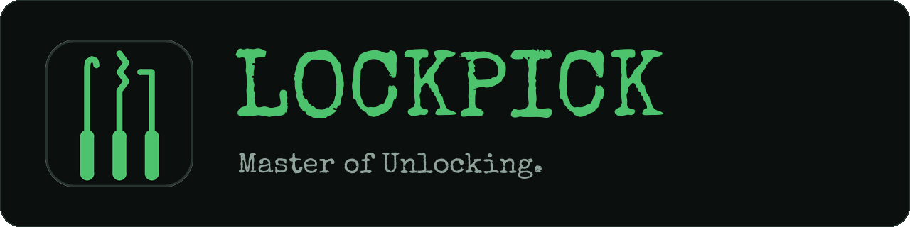
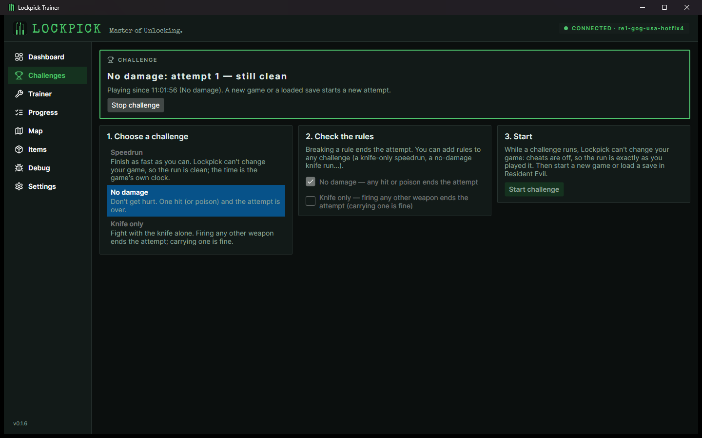
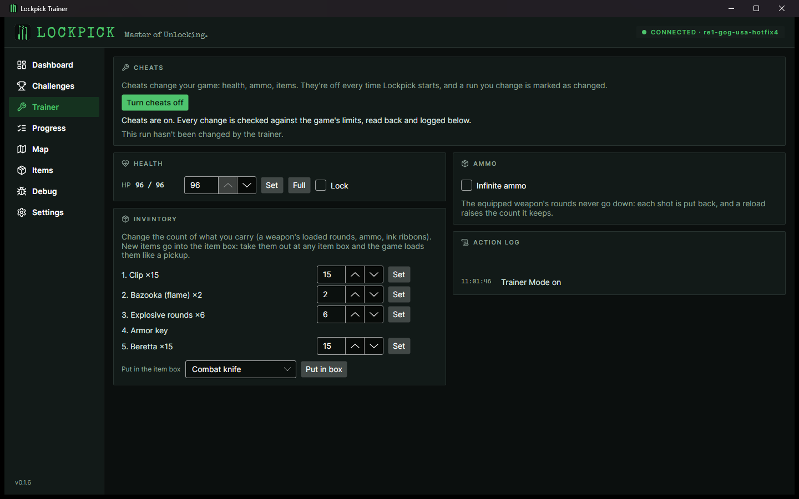
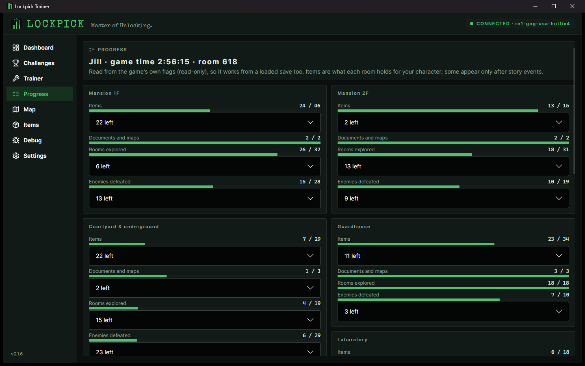
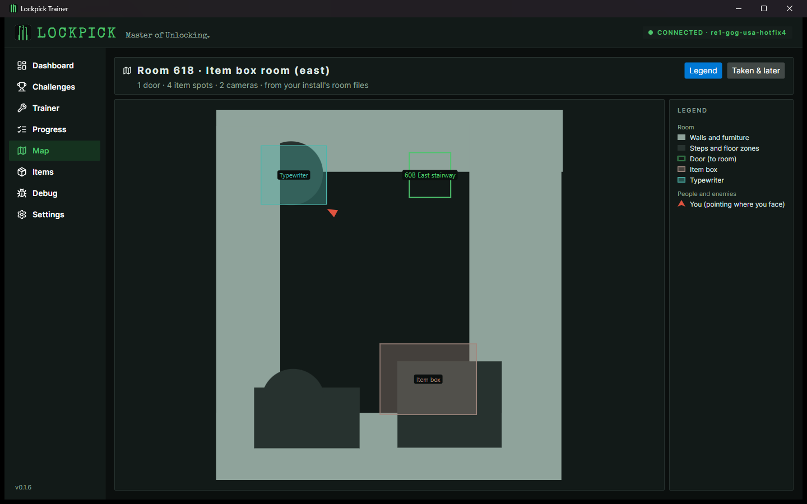
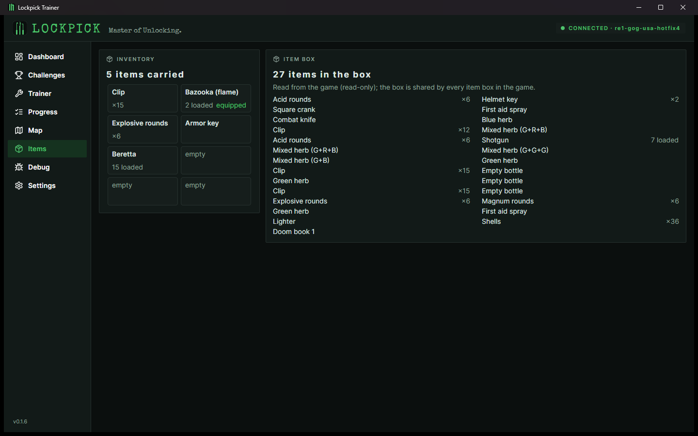
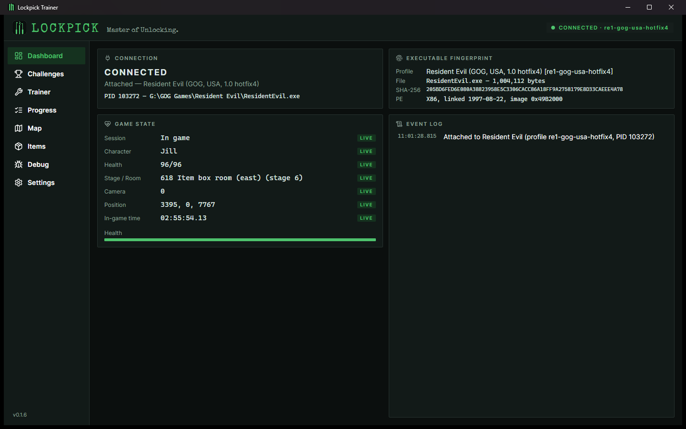
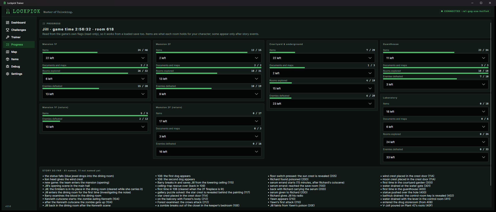
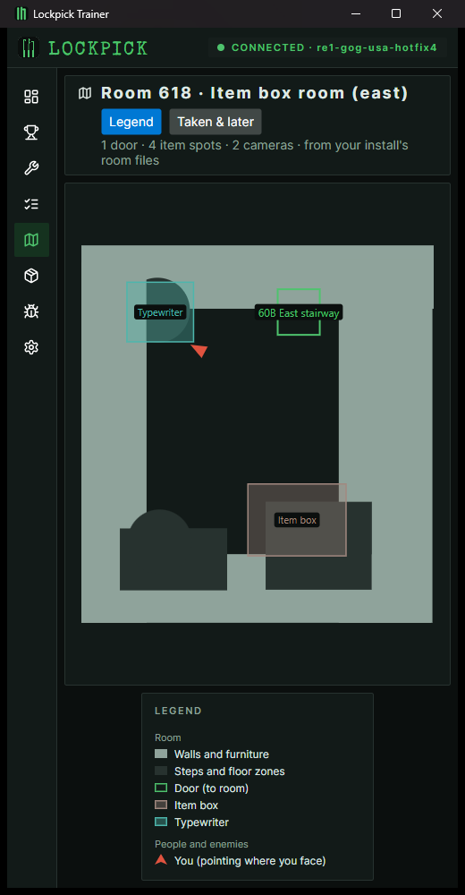

<h1 align="center"></h1>

[](https://github.com/mscrnt/lockpick/releases/latest)
[](https://github.com/mscrnt/lockpick/releases)
[](https://github.com/mscrnt/lockpick/actions/workflows/ci.yml)
[](LICENSE)
[](https://github.com/mscrnt/lockpick/discussions)

Lockpick Trainer is a trainer and gameplay-intelligence platform for the original Resident Evil trilogy
on PC, starting with **Resident Evil (1996), GOG release**. It reads live game state, verifies exactly
which build it is talking to, and is designed to grow into a trainer, overlay, world explorer and
speedrun/challenge suite.

> **Status: 0.2 (core trainer).** Live state, progress, challenges and an opt-in trainer, all validated against the
> real GOG game (Chris and Jill games). See [docs/ROADMAP.md](docs/ROADMAP.md).

## Screenshots

<p align="center">
  
  
</p>
<p align="center"><em>Challenges, step by step (left) and cheats in the Trainer, every change checked and logged (right).</em></p>

<p align="center">
  
  
</p>
<p align="center"><em>Progress per area from the game's own flags (left) and the live room map (right).</em></p>

<p align="center">
  
  
</p>
<p align="center"><em>Inventory and item box (left) and the dashboard with the verified build and live state (right).</em></p>

<p align="center">
  
  
</p>
<p align="center"><em>Every page adapts to the window: wide and ultrawide (left), narrow or portrait (right).</em></p>

## What works

- **Connects safely:** finds the running game and the GOG install, fingerprints the executable (SHA-256 + PE header)
  and refuses unknown builds without opening the process, then verifies the in-memory image before reading.
- **Live game state** 30 times a second (character, HP, room, camera, position, in-game time) and plain-language events
  (game loaded, room changes, damage, saves).
- **Challenges** (Speedrun, No damage, Knife only, rules combinable): Lockpick can't change the game while one runs,
  and the attempt fails on a hit, a shot from anything but the knife, or cheats being switched on.
- **Trainer** (off every time Lockpick starts): set, fill or lock HP; infinite ammo; change what you carry; put any
  item into the item box; hotkeys for all of it. Every change is checked against the game's limits, read back and
  logged, and a changed run is marked as changed.
- **Progress, Map and Items:** how much of each area you've done (items, documents, rooms, enemies) from the game's own
  flags, the current room drawn from your install's room files with you in it, and your inventory and item box.
- **Captures** of play sessions for research (Debug page), with markers from a hotkey or the controller (L2 / LT).
- **API for other tools** (off by default): game state, a live event stream, capture control and, if you allow it,
  trainer commands for scripts, OBS, LiveSplit, a Stream Deck or macros ([docs/API.md](docs/API.md)).
- Installer with automatic updates (Velopack), first-time setup, and layouts for every window size — ultrawide, 1080p,
  side by side and portrait.

Next: **0.3.0** — one app for playing and streaming; see the [roadmap](docs/ROADMAP.md). Already on `main`, not yet
released: an in-game overlay (time and HP with the game's own Fine / Caution / Danger / Poison, a minimap that
opens to the whole room or the whole floor, enemies' HP, what just happened, run splits, big messages), a whole-floor
map put together from the rooms' doors, runs timed on the game's clock with the community's splits, LiveSplit files
and LiveSplit itself ([docs/RUNS.md](docs/RUNS.md)), and OBS pages for the HUD, splits and feed.

## Supported builds

| Game | Build | Status |
|---|---|---|
| Resident Evil | GOG `ResidentEvil.exe` 1.0 hotfix4, SHA-256 `205BD6FE…4A78` | Supported |

Other builds are refused until a verified profile exists — see [docs/COMPATIBILITY.md](docs/COMPATIBILITY.md).

## Install

1. Download **[Lockpick-win-Setup.exe](https://github.com/mscrnt/lockpick/releases/latest/download/Lockpick-win-Setup.exe)**
   from the [latest release](https://github.com/mscrnt/lockpick/releases/latest) and run it. It installs for your user
   only (no administrator rights) and adds Start menu and desktop shortcuts. Windows SmartScreen may warn because the
   build is not code-signed yet: *More info → Run anyway*.
2. The first launch walks you through a short setup: finding the game (with a build check) and update preferences.
3. Start Resident Evil normally (not from the GOG installer's elevated "Launch" button). Lockpick connects automatically.

**Updates:** Lockpick checks GitHub for new versions 20 seconds after starting and every 6 hours (can be turned off
in Settings). When one is available the version label in the sidebar turns green; *Settings → Update* downloads it
and restarts. Nothing installs without your click. A portable zip (also self-updating) is on each release page.

## Build from source

Requirements: Windows 10/11 x64, [.NET 10 SDK](https://dotnet.microsoft.com/download).

```powershell
git clone https://github.com/mscrnt/lockpick; cd lockpick
dotnet run --project src/Lockpick.App
dotnet test tests/Lockpick.Tests                         # tests
dotnet run --project tools/Lockpick.Probe -- identify    # check your installed build
```

## Help out

Lockpick verifies everything against the real game. Recording a play session (any kind; speedruns are great)
helps the most: install Lockpick, open **Debug → Start capture**, play, then *Stop and save* and send the zip
([details](docs/CAPTURE.md)). The **[bounty list](docs/CAPTURE_BOUNTIES.md)** shows what's still needed — bounties are unpaid; the reward is
your name in the app's credits. Planning lives on the
[roadmap board](https://github.com/users/mscrnt/projects/8); questions and ideas go to
[Discussions](https://github.com/mscrnt/lockpick/discussions). See [CONTRIBUTING.md](CONTRIBUTING.md). Helpers are credited in
[CONTRIBUTORS.md](CONTRIBUTORS.md).

Lockpick is free. If you'd like to support its development, you can
[buy me a coffee](https://buymeacoffee.com/mscrnt). Donations are entirely optional: they don't buy features, priority
or bounties.

## Repository layout

```text
src/
  Lockpick.Core/               state model, events, adapter contract, profiles, monitor, trainer, challenges, recording
  Lockpick.Platform.Windows/   Win32 process discovery, memory reads (writes only in Trainer Mode), hotkeys, controllers
  Lockpick.GameAdapter.RE1/    RE1 adapter (the only code that knows RE1 addresses)
  Lockpick.Api/                local API for other tools (off by default)
  Lockpick.App/                Avalonia desktop app
data/games/re1/profiles/       version profiles (addresses, anchors, evidence) — source of truth
tools/Lockpick.Probe/          headless identify / watch / trace / record
tools/Lockpick.Autoplay/       developer-only test harness (virtual controller); not part of the app
tools/autoplay/                developer-only test runners (room survey, save library, scene launcher)
tools/display/                 developer-only display probe (game window, capture, overlay — docs/DISPLAY.md)
tools/fixtures/                trace → recording fixture converter
tests/Lockpick.Tests/          unit, fixture playback and Win32 integration tests
benchmarks/                    BenchmarkDotNet suites
docs/                          architecture, roadmap, research, compatibility, memory map, performance, development
```

## Documentation

- [Roadmap and acceptance criteria](docs/ROADMAP.md)
- [Development guide](docs/DEVELOPMENT.md) — build, test, verify addresses, release
- [Architecture and decisions](docs/ARCHITECTURE.md)
- [Memory map](docs/MEMORY_MAP.md) · [Research](docs/RESEARCH.md) · [Compatibility](docs/COMPATIBILITY.md) · [Performance](docs/PERFORMANCE.md)
- [Display modes, capture and overlays](docs/DISPLAY.md) — how the game's window behaves in every mode (for overlays and OBS)
- [Runs and splits](docs/RUNS.md) — the run timer, split sets and triggers, LiveSplit files and LiveSplit itself

## Safety and integrity

- Read-only unless you turn cheats on. No game files are modified, no game binaries or assets are distributed.
- The one exception is opt-in: the Debug page's *Ask me about unknown events* capture mode can pause (suspend) the
  game process while you answer a question. It never writes to the game, and the game resumes as soon as you answer.
- Exact build identification and runtime image verification before any read; reads are confined to the
  verified module image.
- Cheats (Trainer Mode) are off every time Lockpick starts. Turning them on opens a separate write handle; every
  write is typed, bounded, read back and logged, and a run with changes is marked. While a challenge runs no write
  handle exists. Challenge Mode records what Lockpick did — it is not an anti-cheat system.

## Known limitations

- Only the GOG USA 1.0 hotfix4 build is supported.
- While choosing a save file on the load screen, the previous game's values are still shown for a few seconds.
- After a death, values are hidden until the next game initializes (the dead game's data lingers in memory).
- The game pauses and its window goes black whenever it isn't the active window (original behavior), so a window or
  game capture in OBS loses the picture while you click elsewhere. In exclusive fullscreen it minimizes instead
  ([docs/DISPLAY.md](docs/DISPLAY.md)).
- If the game runs elevated, Lockpick must also run elevated to read it.

## Credits

Contributors and capture volunteers are listed in [CONTRIBUTORS.md](CONTRIBUTORS.md).

Research builds on the work of the RE1 decompilation (ecruells), the RE1 Mod SDK and Classic REbirth
(Gemini-Loboto3), the RE1 autosplitter (deserteagle417 / Dchaps), BioRand (Ted John) and
Windows-ResidentEvil1-MODS (shadwork). No code from these projects is included; see
[THIRD_PARTY_NOTICES.md](THIRD_PARTY_NOTICES.md). Resident Evil is a trademark of Capcom; this project is
not affiliated with or endorsed by Capcom or GOG.

## License

[MIT](LICENSE)
